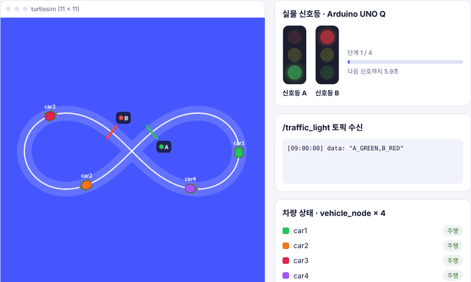
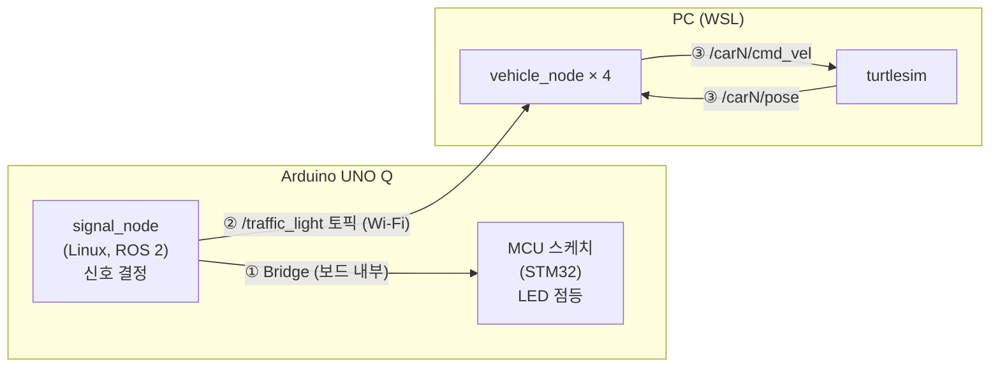

# ROS프로그래밍 기말 프로젝트: 주제선정

## 1. 작품명

**스마트 신호등 기반 8자 교차로 자율주행 시뮬레이션**

---

## 2. 작품설명

실물 신호등(UNO Q + LED)이 보내는 신호를 받아, turtlesim의 거북이 차량들이 **8자 도로를 계속 돌며 교차점에서 스스로 멈추고 출발**하는 시스템이다.

```
        ╭──────╮       ╭──────╮
      ╱    🐢    ╲   ╱    🐢    ╲
     │            ╲ ╱            │
     │             ✚             │    ✚ = 교차점
     │            ╱ ╲            │
      ╲    🐢    ╱   ╲    🐢    ╱
        ╰──────╯       ╰──────╯
```

### 신호 동작

- 교차점에서는 **↙ 방향**으로 가는 차와 **↘ 방향**으로 가는 차가 엇갈린다.
- 방향마다 신호등이 1개씩 있다. (신호등 A: ↙ 방향, 신호등 B: ↘ 방향)
- **한쪽이 초록이면 다른 쪽은 빨강**이다. 일정 시간마다 서로 바뀐다.

| 순서 | 신호등 A (↙) | 신호등 B (↘) | 결과 |
|---|---|---|---|
| 1 | 초록 | 빨강 | ↙ 방향 차만 통과, ↘ 방향 차는 교차점 앞에서 대기 |
| 2 | 노랑 | 빨강 | 곧 바뀜 → ↙ 방향 차도 교차점 앞에서 정지 |
| 3 | 빨강 | 초록 | ↙ 방향 차만 통과, ↗ 방향 차는 대기 |
| 4 | 빨강 | 노랑 | 곧 바뀜 → 1번으로 돌아감 |

### 차량 동작

1. 8자 도로를 따라 계속 주행한다.
2. 교차점에 다가가면 **자기가 지나갈 방향의 신호**를 확인한다. 빨강·노랑이면 멈추고, 초록이면 통과한다.
3. 앞차와 너무 가까우면 멈춘다.
   



### 통신 방식



| 구간 | 방법 | 주고받는 내용 |
|---|---|---|
| ① UNO Q 내부 (Linux → MCU) | UNO Q 내장 Bridge(RPC) | "A 초록, B 빨강" → MCU가 LED 6개 점등 |
| ② UNO Q → PC | ROS 2 토픽 `/traffic_light` (같은 Wi-Fi, 같은 `ROS_DOMAIN_ID`) | 현재 신호 상태 |
| ③ PC 내부 | ROS 2 토픽 | 차량 위치(`pose`) 수신, 속도 명령(`cmd_vel`) 전송 |

- 차량은 LED를 카메라로 보는 것이 아니라 **네트워크로 신호 정보를 받는다.**
- 신호등(UNO Q)과 차량(PC)은 서로 다른 장치에서 실행되며 ROS 2로 연결된다.

---

## 3. 선정이유

1. **신호 정보를 통신으로 받는 자율주행 방식 (V2I)**
   자율주행차는 신호등을 카메라로 보는 것 외에, 신호등이 보내는 신호 정보를 **통신으로 받아** 판단하기도 한다(V2I, 차량–인프라 통신). 이 작품은 신호등이 `/traffic_light` 토픽으로 신호를 보내고 차량이 이를 받아 정지·출발을 결정하는 구조로 이 방식을 구현한다.

2. **UNO Q가 필요한 이유**
   신호등은 현장에서 LED를 직접 켜야 하므로 **MCU**가 필요하고, 차량과 통신하려면 **ROS 2가 실행되는 Linux**가 필요하다. UNO Q는 두 가지를 한 보드에 갖추고 있다.

3. **수업 내용 적용**
   - 멀티프로세싱: 차량 1대 = 노드 1개, 4대 동시 실행
   - 네트워크 통신: 토픽으로 신호·위치·속도 전달
   - 분산처리: 신호등(UNO Q)과 차량(PC)이 서로 다른 장치에서 동작

---

## 4. 필요기술

| 구분 | 내용 |
|---|---|
| 하드웨어 | Arduino UNO Q, LED 6개(빨강·노랑·초록 × 2), 저항 6개, 브레드보드 |
| ROS 2 | 노드, 토픽, 서비스(`/spawn`, `/set_pen`), launch, 멀티 머신 통신(`ROS_DOMAIN_ID`) |
| UNO Q | MCU 스케치(LED 제어), Bridge(Linux ↔ MCU), Linux에서 ROS 2 노드 실행 |
| 8자 주행 | 8자 곡선 위의 목표점을 조금씩 앞으로 옮기고, 거북이가 그 점을 따라가도록 P 제어 |
| 정지 판단 | 교차점 앞 + 내 방향 신호가 빨강·노랑 → 정지 / 앞차와 가까움 → 정지 |
| 언어·도구 | C++(rclcpp), Python(rclpy), Arduino, colcon, Git |

---

## 일정

| 주차 | 날짜 | 내용 |
|---|---|---|
| 1주차 | 11/23 | 주제 선정 발표 |
| | 11/25 | 개념 설계 발표 (주제 수정) |
| 2주차 | 11/30 | 구현: UNO Q ↔ PC 통신, 신호등 LED, 거북이 8자 주행 |
| | 12/2 | 구현: 신호 정지·차간 거리, 차량 4대 통합 / 중간 발표 |
| 3주차 | 12/7 | 최종 발표 (실물 LED + turtlesim 화면 시연) |
