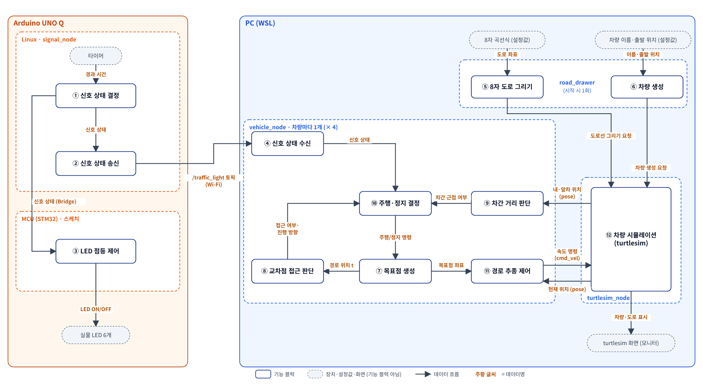

# 🚦 개념 설계 — 스마트 신호등 기반 8자 교차로 자율주행 시뮬레이션

## 1. 세부 기능 정의

| 번호 | 기능 (블럭명) | 실행 위치 | 하는 일 | 입력 데이터 | 출력 데이터 |
|---|---|---|---|---|---|
| ① | 신호 상태 결정 | UNO Q · Linux | 일정 시간마다 신호를 다음 단계로 바꾼다 | 경과 시간 | 신호 상태 |
| ② | 신호 상태 송신 | UNO Q · Linux | 신호 상태를 ROS 2 토픽으로 PC에 보낸다 | 신호 상태 | `/traffic_light` 토픽 |
| ③ | LED 점등 제어 | UNO Q · MCU | 신호 상태에 맞게 실물 LED 6개를 켠다 | 신호 상태 (Bridge) | LED ON/OFF |
| ④ | 신호 상태 수신 | PC · vehicle_node | 토픽으로 들어온 신호 상태를 받는다 | `/traffic_light` 토픽 | 신호 상태 |
| ⑤ | 8자 도로 그리기 | PC · road_drawer | 시작할 때 화면에 8자 도로선을 그린다 | 도로 좌표 | 도로선 그리기 요청 |
| ⑥ | 차량 생성 | PC · road_drawer | 거북이 차량 4대를 출발 위치에 만든다 | 이름·출발 위치 | 차량 생성 요청 |
| ⑦ | 목표점 생성 | PC · vehicle_node | 8자 곡선 위 목표점을 앞으로 옮긴다 (정지 명령이면 멈춤) | 주행/정지 명령 | 경로 위치 t, 목표점 좌표 |
| ⑧ | 교차점 접근 판단 | PC · vehicle_node | 교차점 앞인지, 어느 방향(↗/↘)으로 지나는지 판단한다 | 경로 위치 t | 접근 여부·진행 방향 |
| ⑨ | 차간 거리 판단 | PC · vehicle_node | 앞차와 너무 가까운지 판단한다 | 내·앞차 위치 (pose) | 차간 근접 여부 |
| ⑩ | 주행·정지 결정 | PC · vehicle_node | 신호·교차점·차간 거리를 보고 갈지 멈출지 정한다 | 신호 상태, 접근 여부·진행 방향, 차간 근접 여부 | 주행/정지 명령 |
| ⑪ | 경로 추종 제어 | PC · vehicle_node | 목표점을 향하도록 속도를 계산한다 (P 제어) | 목표점 좌표, 현재 위치 (pose) | 속도 명령 (`cmd_vel`) |
| ⑫ | 차량 시뮬레이션 | PC · turtlesim | 속도 명령대로 거북이를 움직이고 화면에 그린다 | 속도 명령, 도로선 그리기 요청, 차량 생성 요청 | 현재 위치 (pose), 차량·도로 표시 |

> ④ ~ ⑪은 `vehicle_node` 안의 기능이며, 차량 4대가 각자 하나씩 실행한다.

---

## 2. 전체 블럭도

- 네모 = 기능 블럭, 점선 타원 = 외부 입력·출력, 화살표 = 데이터 흐름, 주황 글씨 = 데이터명

---

## 3. 데이터 흐름 요약

| 흐름 | 경로 |
|---|---|
| 신호 흐름 | ① 신호 상태 결정 → ② 송신 → (Wi-Fi) → ④ 수신 → ⑩ 주행·정지 결정 |
| 실물 신호등 | ① 신호 상태 결정 → (Bridge) → ③ LED 점등 제어 → 실물 LED |
| 주행 반복 | ⑩ 결정 → ⑦ 목표점 → ⑪ 경로 추종 → ⑫ turtlesim → 위치(pose) → ⑪ · ⑨ (반복) |
| 시작 준비 | ⑤ 도로 그리기 · ⑥ 차량 생성 → ⑫ turtlesim (시작 시 1회) |
